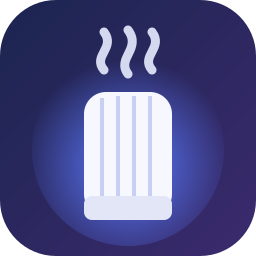
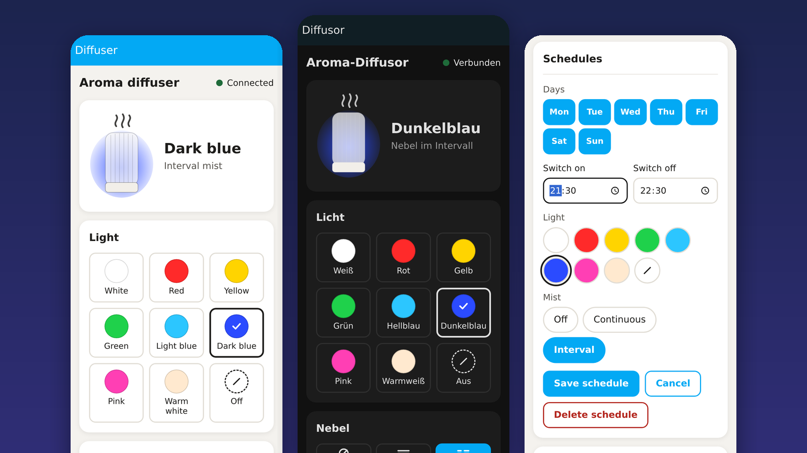
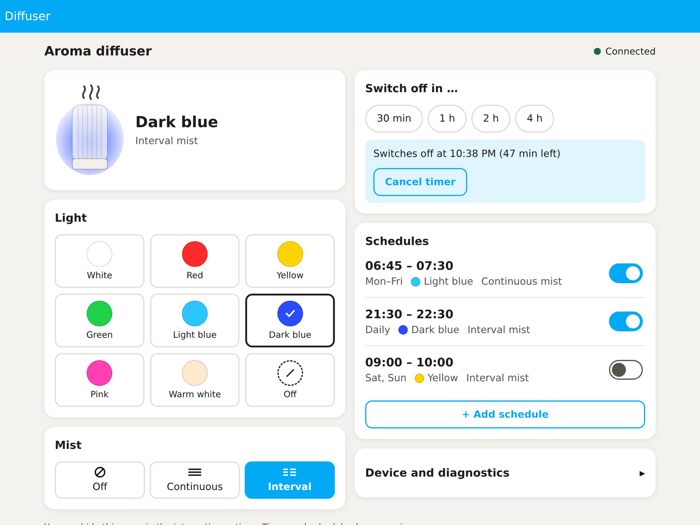
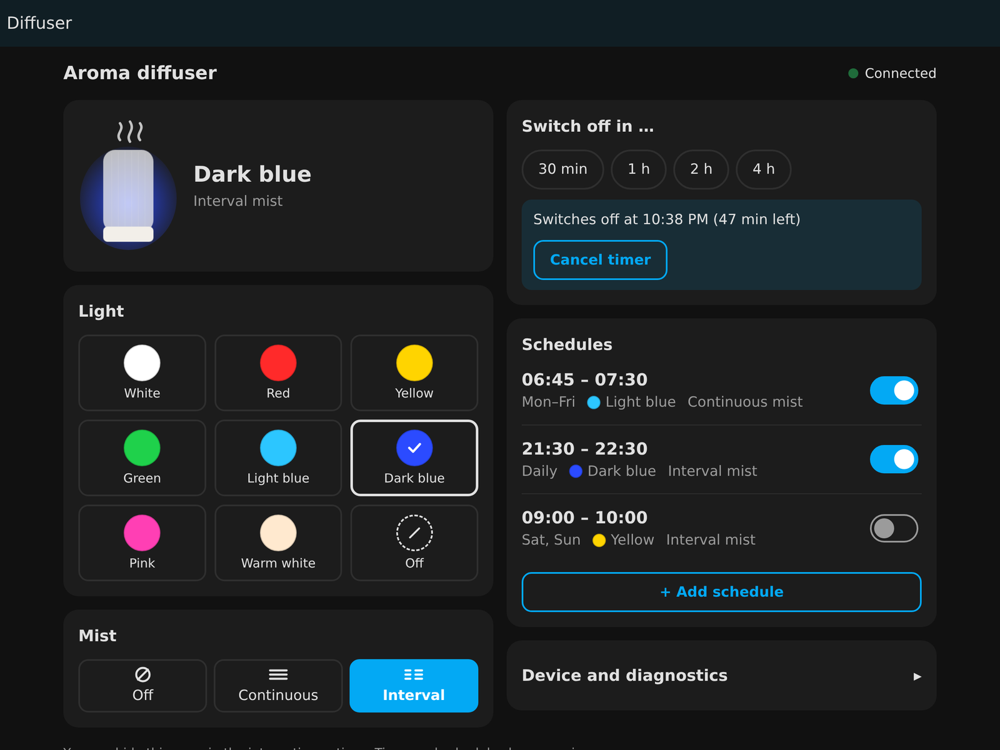

<p align="center">
  
</p>

<h1 align="center">iMist für Home Assistant</h1>

<p align="center">💡 Ideas by <b>Blotto</b> · 🤖 Coded by <b>Claude Opus</b></p>

<p align="center">
  <b>Die App ist weg. Der Diffusor nicht.</b><br>
  Lokale Bluetooth-Steuerung ohne Cloud für den iMist-Aromadiffusor – mit Echtzeit-Zustand, Zeitplänen,<br>
  Ausschalt-Timer und einer schönen Seite in der Seitenleiste.
</p>

<p align="center"><b>Deutsch</b> · <a href="README.en.md">English</a></p>

<p align="center">
  <a href="https://hacs.xyz"></a>
  
  
  
  <a href="LICENSE"></a>
</p>

<p align="center">
  
</p>

## Warum es das gibt

Der iMist-Diffusor ist ein kleiner weißer, gerillter Zylinder mit zwei Tasten, **LIGHT** und **MIST**, und Bluetooth.
Seine iPhone-App ist aus dem App Store verschwunden – und damit jede Möglichkeit, das Gerät vom Telefon aus zu steuern.
Die Hardware funktioniert weiterhin einwandfrei.

Diese Integration holt es zurück: in Home Assistant, ohne Cloud, Konto oder Hersteller-App. Das Protokoll wurde
ermittelt, indem beim Drücken der Tasten die Bluetooth-Meldungen des Geräts mitgelesen wurden. Die ganze Geschichte
samt einem lehrreichen Irrweg steht in [docs/PROTOCOL.md](docs/PROTOCOL.md) (auf Englisch).

## Funktionen

- 🎨 **Licht** – alle acht Farben des Geräts und aus. Wähle in Home Assistant eine Farbe, und die nächstliegende Gerätefarbe wird verwendet.
- 🌫️ **Nebel** – aus, Dauer oder Intervall.
- ⚡ **Echter Zustand statt Annahme** – der Diffusor meldet seinen Zustand zehnmal pro Sekunde. Drückst du eine Taste am Gerät, zieht Home Assistant sofort nach (`local_push`).
- 🗓️ **Zeitpläne** – je Wochentag mit Start- und Endzeit, Farbe und Nebelmodus. Zeitpläne über Mitternacht funktionieren einfach.
- ⏲️ **Ausschalt-Timer** – ausschalten in 30 Min., 1 Std., 2 Std. oder 4 Std. Das Gerät hat keinen eigenen Timer; das übernimmt Home Assistant.
- 🖥️ **Optionale Seite in der Seitenleiste** – große Schaltflächen, telefontauglich, folgt Design und Sprache von Home Assistant (Englisch, Deutsch).
- 🔍 **Automatische Erkennung** – Home Assistant findet den Diffusor von selbst.
- 🩺 **Diagnose** – Signalstärke, letzte Meldung, Rohdaten und Verbindungsabbrüche; ein Klick kopiert alles für einen Fehlerbericht.
- 🔁 **Übersteht alles** – verbindet sich automatisch neu, Zeitpläne und Timer überstehen Neustarts, und die Integration lädt auch, wenn der Diffusor außer Reichweite ist.

<table>
  <tr>
    <td></td>
    <td></td>
  </tr>
</table>

## Wird mein Diffusor unterstützt?

Sehr wahrscheinlich ja, wenn alles davon zutrifft:

| Prüfpunkt | Erwartet |
|---|---|
| Aussehen | Weißer, gerillter, durchscheinender Zylinder; Tasten **LIGHT** und **MIST** am Sockel |
| Bluetooth-Name | `AromaDiffuser` |
| Angekündigter Dienst | `0000fff0-0000-1000-8000-00805f9b34fb` |
| Characteristic | `fff4` mit *read, write, notify* |

Nicht sicher? Installiere einen BLE-Explorer wie **nRF Connect** auf deinem Telefon, verbinde dich mit `AromaDiffuser`,
schalte die Benachrichtigungen auf `fff4` ein und drücke am Gerät **LIGHT**. Bei jedem Druck sollten sich drei Bytes wie
`aa 00 18` ändern. Das Schreiben von `aa 20 18` schaltet rotes Licht mit Dauernebel ein.

> [!NOTE]
> Manche Diffusoren, die mit der Android-App **„Aroma Diffuser“** (`com.spark.imist.aroma`) verkauft werden, nutzen ein
> *anderes* Protokoll (Dienst `f501`). Sie werden **noch nicht** unterstützt – und die Integration erfasst sie auch nicht versehentlich.
> Pull Requests sind willkommen, siehe [CONTRIBUTING.md](CONTRIBUTING.md) (auf Englisch).

## Installation

### HACS (empfohlen)

1. HACS → ⋮ → **Benutzerdefinierte Repositories** → `https://github.com/ElektroGandhi/iMist` hinzufügen, Kategorie **Integration**.
2. **iMist Aroma Diffuser** installieren und Home Assistant neu starten.

### Von Hand

`custom_components/imist` nach `config/custom_components/` kopieren und Home Assistant neu starten.

## Einrichtung

1. Stelle sicher, dass Home Assistant Bluetooth hat (ein lokaler Adapter oder ein ESPHome-Bluetooth-Proxy).
2. Schalte den Diffusor ein. Er erscheint unter **Einstellungen → Geräte & Dienste → Entdeckt**.
   Sonst: **Integration hinzufügen → iMist Aroma Diffuser**.
3. Optional: **Konfigurieren** → *Seite „Diffusor“ in der Seitenleiste zeigen*.

## Entitäten

| Entität | Funktion |
|---|---|
| `light.…_licht` | an/aus, 8 Farben als Effekte (`white`, `red`, `yellow`, `green`, `light_blue`, `dark_blue`, `pink`, `warm_white`), jede RGB-Farbe wird auf die nächstliegende gerundet |
| `select.…_nebel` | `off` (Aus), `continuous` (Dauer), `interval` (Intervall) |

Es gibt **keine Helligkeit** und **keinen Wasserstandssensor**: Das Geräteprotokoll kennt beides nicht (Helligkeit wurde am Gerät getestet).

## Beispiele für Automationen

Schlafenszeit – dunkelblaues Licht und Intervallnebel für eine Stunde:

```yaml
alias: Diffusor zur Schlafenszeit
triggers:
  - trigger: time
    at: "21:30:00"
actions:
  - action: light.turn_on
    target: { entity_id: light.imist_aroma_diffuser_licht }
    data: { effect: dark_blue }
  - action: select.select_option
    target: { entity_id: select.imist_aroma_diffuser_nebel }
    data: { option: interval }
  - delay: "01:00:00"
  - action: light.turn_off
    target: { entity_id: light.imist_aroma_diffuser_licht }
  - action: select.select_option
    target: { entity_id: select.imist_aroma_diffuser_nebel }
    data: { option: "off" }
```

Willkommen zu Hause – Nebel, wenn die erste Person ankommt:

```yaml
alias: Diffusor zur Begrüßung
triggers:
  - trigger: state
    entity_id: zone.home
    from: "0"
actions:
  - action: select.select_option
    target: { entity_id: select.imist_aroma_diffuser_nebel }
    data: { option: continuous }
```

Entitäts-IDs hängen von deiner Einrichtung und der Sprache von Home Assistant ab (auf Englisch `…_light` und `…_mist`) – prüfe sie unter **Einstellungen → Geräte**.

## Das Protokoll in 30 Sekunden

Alles läuft über eine einzige Characteristic, `fff4`. Befehle und Zustandsmeldungen sehen gleich aus: **`aa MM LL`**.

| Byte | Bedeutung |
|---|---|
| `aa` | Kopfbyte |
| `MM` | Nebel – `00` aus · `20` Dauer · `40` Intervall |
| `LL` | Licht – `00` aus · `08` weiß · `18` rot · `30` gelb · `20` grün · `40` hellblau · `28` dunkelblau · `38` pink · `48` warmweiß |

Keine Prüfsumme, keine Kopplung, kein Handshake. Du willst es ohne Home Assistant ausprobieren? Siehe
[`examples/control.py`](examples/control.py) – 30 Zeilen Python. Alle Einzelheiten in [docs/PROTOCOL.md](docs/PROTOCOL.md) (auf Englisch).

## Fehlersuche

| Problem | Das hilft |
|---|---|
| Nicht erkannt | Der Diffusor muss Strom haben, und kein Telefon darf mit ihm verbunden sein. Prüfe, ob Home Assistant `AromaDiffuser` unter **Einstellungen → Bluetooth → Advertisement-Monitor** sieht. |
| Entitäten zeitweise *nicht verfügbar* | Bluetooth-Reichweite. Ab −75 dBm und darunter reißen Verbindungen ab. Stelle den Diffusor näher heran oder einen [ESPHome-Bluetooth-Proxy](https://esphome.io/components/bluetooth_proxy.html) in seine Nähe (aktive Verbindungen werden von Home Assistant unterstützt; vom Autor noch nicht getestet). |
| „Service fff0 missing“ im Protokoll | Dein Diffusor spricht ein anderes Protokoll, siehe *Wird mein Diffusor unterstützt?* |
| Alles andere | Seite öffnen → *Gerät und Diagnose* → **Diagnose kopieren** und an ein [Issue](https://github.com/ElektroGandhi/iMist/issues) anhängen. |

## Mitmachen

Fehlerberichte, Geräteberichte und Pull Requests sind willkommen – besonders für andere Diffusor-Familien.
Siehe [CONTRIBUTING.md](CONTRIBUTING.md) (auf Englisch). Die Tests laufen auch ohne installiertes Home Assistant:

```bash
pip install pytest && pytest -q
```

## Wer das gemacht hat

💡 **Ideas by Blotto · 🤖 Coded by Claude Opus**

Die Idee, die Tests an echter Hardware und jede Entscheidung: **Blotto**. Ich kann selbst nicht programmieren – aber
ich weiß, was ich will, und ich weiß die Weltwissens-Dampfmaschine zu bedienen. Jede Zeile Code, das Reverse
Engineering und die Doku: **Claude Opus** (Anthropic) als mein Programmier-Agent.

## Haftungsausschluss

Dies ist ein unabhängiges Gemeinschaftsprojekt. Es ist nicht verbunden mit den Herstellern des iMist-Diffusors oder
einer App und wird von ihnen weder unterstützt noch empfohlen. Alle Produktnamen und Marken gehören ihren Inhabern.
Nutzung auf eigene Gefahr.

## Lizenz

[MIT](LICENSE)
