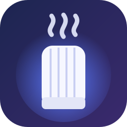
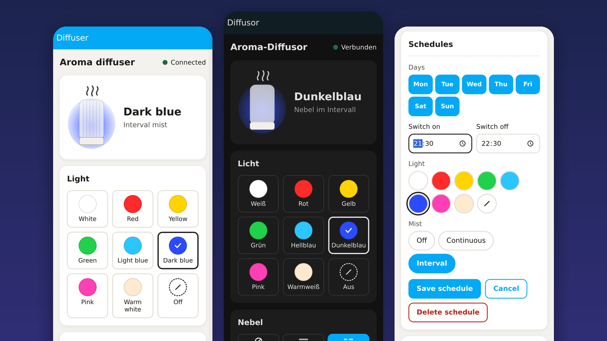
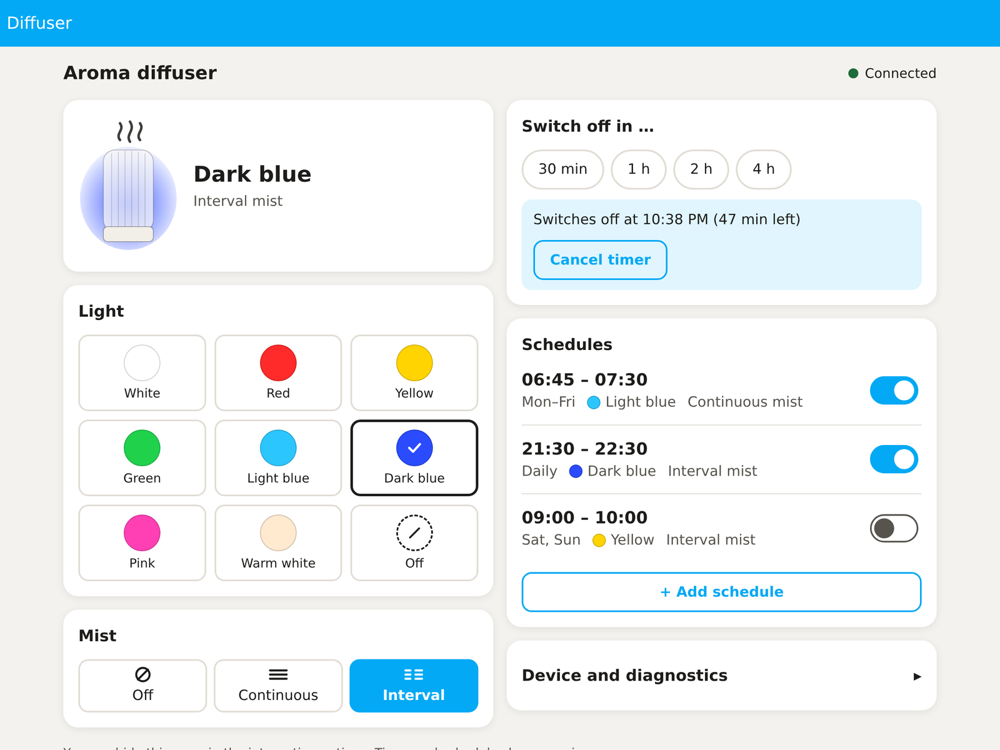
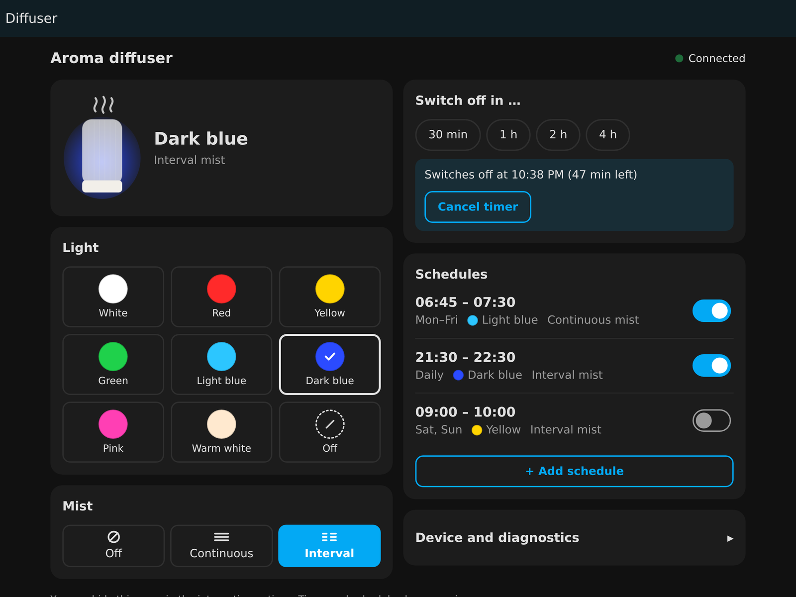

<p align="center">
  
</p>

<h1 align="center">iMist for Home Assistant</h1>

<p align="center">
  <b>The app is gone. The diffuser is not.</b><br>
  Local, cloud-free Bluetooth control for the iMist aroma diffuser – with a real-time state, schedules,<br>
  a sleep timer and a beautiful sidebar panel.
</p>

<p align="center">
  <a href="https://hacs.xyz"></a>
  
  
  
  <a href="LICENSE"></a>
  <a href="README.de.md"></a>
</p>

<p align="center">
  
</p>

## Why this exists

The iMist diffuser is a small white, ribbed cylinder with two buttons, **LIGHT** and **MIST**, and Bluetooth.
Its iPhone app has disappeared from the App Store, and with it every way to control the device from a phone.
The hardware still works perfectly.

This integration brings it back – into Home Assistant, without any cloud, account or vendor app. The protocol
was worked out by watching the device's own Bluetooth reports while pressing its buttons. The full story,
including one instructive wrong turn, is in [docs/PROTOCOL.md](docs/PROTOCOL.md).

## Features

- 🎨 **Light** – all eight colors of the device plus off. Pick a color in Home Assistant and the closest device color is used.
- 🌫️ **Mist** – off, continuous or interval.
- ⚡ **Real state, not a guess** – the diffuser reports its state ten times per second. Press a button on the device and Home Assistant follows instantly (`local_push`).
- 🗓️ **Schedules** – per weekday, with start and end time, color and mist mode. Schedules across midnight just work.
- ⏲️ **Sleep timer** – switch off in 30 min, 1 h, 2 h or 4 h. The device has no timer of its own; Home Assistant does it.
- 🖥️ **Optional sidebar panel** – large touch targets, works on phones, follows your Home Assistant theme and language (English, German).
- 🔍 **Discovery** – Home Assistant finds the diffuser on its own.
- 🩺 **Diagnostics** – signal strength, last report, raw bytes and disconnects; one click copies everything for a bug report.
- 🔁 **Survives everything** – reconnects automatically, schedules and timer survive restarts, and the integration loads even when the diffuser is out of range.

<table>
  <tr>
    <td></td>
    <td></td>
  </tr>
</table>

## Is my diffuser supported?

Most likely yes, if all of this is true:

| Check | Expected |
|---|---|
| Look | White, ribbed, translucent cylinder; buttons **LIGHT** and **MIST** on the base |
| Bluetooth name | `AromaDiffuser` |
| Advertised service | `0000fff0-0000-1000-8000-00805f9b34fb` |
| Characteristic | `fff4` with *read, write, notify* |

Not sure? Install a BLE explorer such as **nRF Connect** on your phone, connect to `AromaDiffuser`, enable
notifications on `fff4` and press **LIGHT** on the device. You should see three bytes like `aa 00 18` change with
every press. Writing `aa 20 18` turns on red light with continuous mist.

> [!NOTE]
> Some diffusers sold with the Android app **“Aroma Diffuser”** (`com.spark.imist.aroma`) use a *different*
> protocol (service `f501`). They are **not** supported yet – and the integration will not pick them up by mistake.
> Pull requests welcome, see [CONTRIBUTING.md](CONTRIBUTING.md).

## Installation

### HACS (recommended)

1. HACS → ⋮ → **Custom repositories** → add `https://github.com/ElektroGandhi/iMist`, category **Integration**.
2. Install **iMist Aroma Diffuser** and restart Home Assistant.

### Manual

Copy `custom_components/imist` into `config/custom_components/` and restart Home Assistant.

## Setup

1. Make sure Home Assistant has Bluetooth (a local adapter or an ESPHome Bluetooth proxy).
2. Switch on the diffuser. It shows up under **Settings → Devices & services → Discovered**.
   Otherwise: **Add integration → iMist Aroma Diffuser**.
3. Optional: **Configure** → *Show the Diffuser page in the sidebar*.

## Entities

| Entity | What it does |
|---|---|
| `light.…_light` | on/off, 8 colors as effects (`white`, `red`, `yellow`, `green`, `light_blue`, `dark_blue`, `pink`, `warm_white`), any RGB color is rounded to the nearest one |
| `select.…_mist` | `off`, `continuous`, `interval` |

There is **no brightness** and **no water-level sensor**: the device protocol has neither (brightness was tested on the device).

## Automation examples

Bedtime – dark blue light and interval mist for one hour:

```yaml
alias: Diffuser at bedtime
triggers:
  - trigger: time
    at: "21:30:00"
actions:
  - action: light.turn_on
    target: { entity_id: light.imist_aroma_diffuser_light }
    data: { effect: dark_blue }
  - action: select.select_option
    target: { entity_id: select.imist_aroma_diffuser_mist }
    data: { option: interval }
  - delay: "01:00:00"
  - action: light.turn_off
    target: { entity_id: light.imist_aroma_diffuser_light }
  - action: select.select_option
    target: { entity_id: select.imist_aroma_diffuser_mist }
    data: { option: "off" }
```

Welcome home – mist when the first person arrives:

```yaml
alias: Diffuser welcome
triggers:
  - trigger: state
    entity_id: zone.home
    from: "0"
actions:
  - action: select.select_option
    target: { entity_id: select.imist_aroma_diffuser_mist }
    data: { option: continuous }
```

Entity IDs depend on your setup – check them under **Settings → Devices**.

## The protocol in 30 seconds

Everything goes through one characteristic, `fff4`. Commands and state reports look the same: **`aa MM LL`**.

| Byte | Meaning |
|---|---|
| `aa` | header |
| `MM` | mist – `00` off · `20` continuous · `40` interval |
| `LL` | light – `00` off · `08` white · `18` red · `30` yellow · `20` green · `40` light blue · `28` dark blue · `38` pink · `48` warm white |

No checksum, no pairing, no handshake. Want to try it without Home Assistant? See
[`examples/control.py`](examples/control.py) – 30 lines of Python. Full details in [docs/PROTOCOL.md](docs/PROTOCOL.md).

## Troubleshooting

| Problem | Try this |
|---|---|
| Not discovered | The diffuser must be powered and no phone may be connected to it. Check that Home Assistant sees `AromaDiffuser` under **Settings → Bluetooth → Advertisement monitor**. |
| Entities *unavailable* now and then | Bluetooth range. At −75 dBm and below connections drop. Move the diffuser closer or add an [ESPHome Bluetooth proxy](https://esphome.io/components/bluetooth_proxy.html) near it (active connections are supported by Home Assistant; not yet tested by the author). |
| “Service fff0 missing” in the log | Your diffuser speaks another protocol, see *Is my diffuser supported?* |
| Anything else | Open the panel → *Device and diagnostics* → **Copy diagnostics**, and attach it to an [issue](https://github.com/ElektroGandhi/iMist/issues). |

## Contributing

Bug reports, device reports and pull requests are welcome – especially for other diffuser families.
See [CONTRIBUTING.md](CONTRIBUTING.md). Tests run without Home Assistant installed:

```bash
pip install pytest && pytest -q
```

## Disclaimer

This is an independent community project. It is not affiliated with, endorsed by or connected to the makers of
the iMist diffuser or of any app. All product names and trademarks belong to their owners. Use at your own risk.

## License

[MIT](LICENSE)
